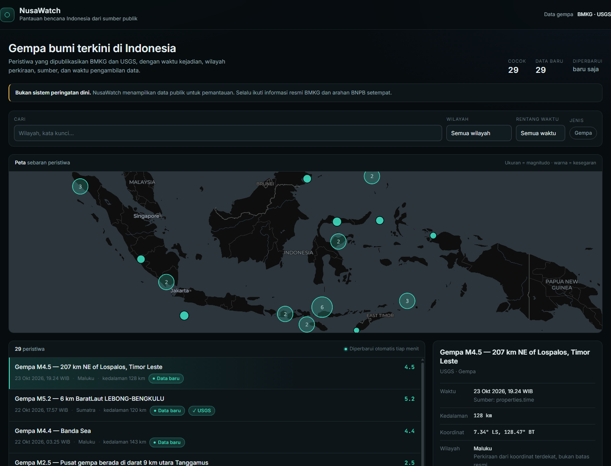
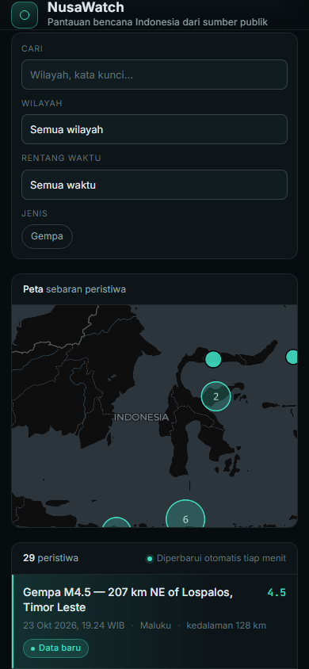
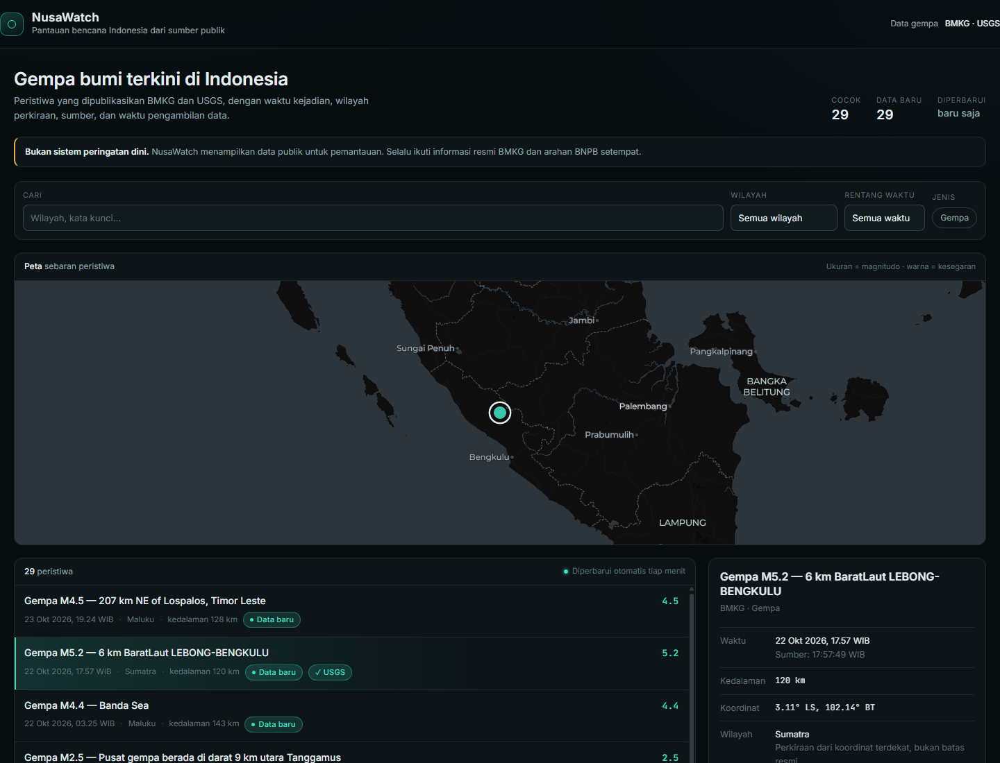

# NusaWatch — operations and deployment

NusaWatch is a fenced, Indonesia-first earthquake watch surface built on a fork
of [OSIRIS](../..). It is **not** an official BMKG product and **not** an early
warning system. It shows what public catalogues published, with provenance and
an explicit freshness state, and it says "tidak diketahui" when a source did not
publish something.

The upstream OSIRIS dashboard remains in the repository and on `/` when the
fence is off. A NusaWatch deployment turns the fence on and serves only the
surface described below.

## Surface

| Route | Fenced behaviour |
|---|---|
| `/` | `307` redirect to `/watch` |
| `/watch`, `/watch/*` | served |
| `/api/nusawatch/events`, `/api/nusawatch/sources` | served |
| `/api/health` | served (infrastructure) |
| `/robots.txt`, `/sitemap.xml` | rewritten for NusaWatch, never the OSIRIS copies |
| `/_next/static/*`, `/vendor/*`, other static assets | served by the framework |
| everything else (`/bolags`, `/api/osint/*`, `/api/scanner`, `/api/earthquakes`, …) | `404` |

The fence lives in `src/middleware.ts` and is gated by `NUSAWATCH_FENCE=1`. With
the variable unset, the middleware behaves like the upstream one (analytics
included) and the whole OSIRIS application is reachable.

## Architecture

```
BMKG (3 feeds) ─┐
                ├─ adapters → canonical event → cache (TTL) → cross-source merge
USGS FDSN ──────┘                                             │
                                                              ▼
                                   GET /api/nusawatch/events ──→ /watch (client)
```

- **Adapters** — `src/lib/nusawatch/sources/bmkg.ts` and `sources/usgs.ts`.
  They fetch, validate and map upstream payloads. They do not filter for display
  and they never invent a timestamp, coordinate or magnitude.
- **Registry** — `registry.ts` holds one descriptor per source: feed, homepage,
  attribution, TTL, freshness window and the things the feed cannot tell you.
  No secrets: both sources are unauthenticated.
- **Cache** — `cache.ts` is an in-process TTL cache with in-flight deduplication
  and a stale fallback. It is per instance; there is no shared cache.
- **Merge** — `dedupe.ts` folds a second catalogue into the primary one. BMKG
  remains authoritative for display text; a match only adds a `crossChecks`
  entry, so magnitude and hypocentre disagreements stay visible.
- **Service** — `service.ts` loads both sources in parallel and produces the
  events plus one status report per source. The route cannot disagree with the
  UI about health because both read the same report.
- **UI** — `src/app/watch/` and `src/components/nusawatch/`. The list is the
  primary, keyboard-accessible surface. The map (`EventMap.tsx`) is a secondary
  view: MapLibre with clustering, a local Dark Matter style, and list/map
  selection sync. It is `aria-hidden`; every marker has a list row.

### Data rules

- Display text (title, `potential`, felt reports) comes from the highest-priority
  BMKG feed: `gempaterkini` → `autogempa` → `gempadirasakan`.
- `Potensi` is quoted BMKG text, labelled "Potensi — teks BMKG". It is never
  rendered as our tsunami verdict.
- Freshness is about **our copy**, computed from the fetch time, never from the
  event time.
- Cross-source identity: same event only when origin times are within **120
  seconds** and hypocentres within **200 km**. Missing time or coordinates means
  "cannot prove identity" and the record stays separate.
- Region labels are approximations from a coordinate box (with a 1.0° snap),
  not administrative boundaries. The detail panel says so.

## API

### `GET /api/nusawatch/events`

| Parameter | Meaning |
|---|---|
| `category` | `earthquake`, `flood`, `cyclone`, `volcano`, `fire`, `other` |
| `region` | `sumatra`, `java`, `kalimantan`, `sulawesi`, `papua`, `bali-nusa-tenggara`, `maluku`, `unknown` |
| `since`, `until` | ISO-8601 timestamps |
| `bbox` | `west,south,east,north` |
| `q` | free text over title/location |
| `limit` | page size, clamped by the server |

Unusable but recognised parameters are returned in `ignoredParams`; unknown keys
are ignored. The response contains `events`, `total`, `matched`, `partial`,
`sources[]`, `generatedAt` and `ignoredParams`.

Status: `200` even when one source fails (`partial=true`,
`X-NusaWatch-Partial: true`); `503` only when every source failed.
`Cache-Control: s-maxage=60, stale-while-revalidate=300`; `no-store` on failure.

### `GET /api/nusawatch/sources`

Registry, cache state and last fetch per source. Useful for a status page and
for checking a deployment after a source changes shape.

### `GET /api/health`

Generic health payload. Reachable under the fence so orchestrators can probe it.

## Environment

| Variable | Required | Effect |
|---|---|---|
| `NUSAWATCH_FENCE` | yes, set to `1` | Enables the surface fence, `/` → `/watch`, the analytics skip and the NusaWatch robots/sitemap |
| `PORT` | standalone only | Listen port (default `3000`) |
| `HOSTNAME` | standalone only | Bind address (default `0.0.0.0`) |
| `UMAMI_WEBSITE_ID` | no | Upstream OSIRIS analytics only. NusaWatch pages and API routes never beacon, fenced or not |

Do not commit `.env` files. Nothing in the NusaWatch code path needs a key.

## Commands

```bash
# development, with the deployment surface
NUSAWATCH_FENCE=1 npx next dev -p 3100

# checks used for this slice
npx tsc --noEmit
npx vitest run
npx eslint src/app/watch src/app/api/nusawatch src/components/nusawatch \
  src/lib/nusawatch src/middleware.ts src/middleware.test.ts

# production build (standalone output)
npm run build
```

`next.config.ts` sets `output: 'standalone'`, so `next start` warns. Run the
artifact the Dockerfile runs:

```bash
# Next copies public/ into standalone but not .next/static
cp -r .next/static .next/standalone/.next/static   # PowerShell: Copy-Item -Recurse
cd .next/standalone
NUSAWATCH_FENCE=1 PORT=3000 HOSTNAME=0.0.0.0 node server.js
```

Docker does the copy for you (`Dockerfile`, runtime stage) and starts
`node server.js`.

## Deployment checklist

1. Build with `NUSAWATCH_FENCE=1` (the fence is read at request time, but a
   fenced build keeps every environment consistent).
2. Start the standalone server with `NUSAWATCH_FENCE=1`.
3. Verify the surface, not just the port:

   ```bash
   curl -sI  http://host/            # 307 -> /watch
   curl -s   http://host/watch       # 200, NusaWatch <title>, no JSON-LD
   curl -s   http://host/api/nusawatch/events   # 200, sources: bmkg + usgs
   curl -sI  http://host/api/health  # 200
   curl -sI  http://host/api/earthquakes        # 404
   curl -sI  http://host/bolags                 # 404
   curl -s   http://host/robots.txt  # NusaWatch, not OSIRIS
   ```

4. Confirm the map loads: the page makes one request to
   `/dark-matter-style.json` and one to `/vendor/maplibre/<version>/…`.
5. Check `/api/nusawatch/sources` after 5–10 minutes: `health` should be `ok`
   for both sources; `degraded` means stale cache or a partial BMKG response,
   `failed` carries the reason.
6. Do not put a CDN in front of `/api/` that strips `X-NusaWatch-Partial`.

## Screenshots

Captured with Chrome 155 against the production standalone build with
`NUSAWATCH_FENCE=1`.







## Verification recorded for this slice

Run on 2026-10-23 on `master`:

- `npx tsc --noEmit` — PASS.
- `npx vitest run` — PASS: 135 files passed, 2 skipped (137 collected);
  1,546 tests passed, 22 skipped (1,568 collected).
- Targeted `npx eslint` on the NusaWatch surface plus `src/middleware.ts`,
  `src/middleware.test.ts` and `eslint.config.mjs` — 0 problems.
- `npm run lint` (whole repo) — now terminates: 1,636 pre-existing problems
  (464 errors, 1,172 warnings) in 133 upstream files. NusaWatch files: 0.
- `npm run build` — PASS, only the 3 pre-existing Turbopack tracing warnings.
- Standalone artifact with `NUSAWATCH_FENCE=1`: `/watch` 200, API 200 with
  29 live events from 2 sources and `partial=false`, `/api/health` 200, CSS 200,
  `/` 307, `/robots.txt` and `/sitemap.xml` NusaWatch content, `/api/earthquakes`
  and `/bolags` 404.
- Real Chrome via CDP at 1440 px and 390 px: 29 rows, `scrollWidth ===
  clientWidth` (no horizontal overflow), map canvas 1398×380 with CARTO/OSM
  attribution, no page errors, filter → selection → detail flow works, and the
  cross-checked row shows `✓ USGS` with the disagreement in the detail panel.
- Live cross-check at capture time: BMKG M5.2 Bengkulu vs USGS M4.9 — 3.3 s and
  34.1 km apart, shown as one BMKG event with a USGS cross-check; two USGS-only
  events were added to the list rather than dropped.

## Attribution and licences

- **OSIRIS** — MIT. The original `LICENSE` and copyright notices are kept.
  NusaWatch is a fork, not a replacement, and the upstream dashboard still
  builds and runs with the fence off.
- **BMKG** — data is fetched from `data.bmkg.go.id`. BMKG's terms of use have
  **not** been reviewed for redistribution. Treat this as an open risk before a
  public launch; the footer links back to BMKG and does not claim endorsement.
- **USGS** — earthquake catalogue via the FDSN event service. USGS earthquake
  data is public domain; the event page is linked per record.
- **CARTO / OpenStreetMap** — basemap and style. Attribution is rendered by
  MapLibre (`© CARTO, © OpenStreetMap contributors`) and must not be hidden.
- **MapLibre GL JS** — BSD-3-Clause; the worker and shared module are self-hosted
  from the installed package by `tools/prepare-map-worker.mjs`.

## Known limitations

- `/watch` still inherits the OSIRIS manifest, favicons and `themeColor` from the
  root layout. The title, description, canonical and social labels are
  NusaWatch's; the icons are not yet.
- Region labels are coordinate approximations. A Banda Sea event can be labelled
  `maluku`; a Timor-Leste event inside the USGS box can appear too. The title
  keeps the source's own place text.
- BMKG's terms of use are unreviewed, and the feed formats are undocumented —
  the adapters are tested against captured payloads, and a shape change will
  surface as `degraded`/`failed` rather than silently empty.
- Cross-source matching is deliberately conservative. Two genuinely different
  earthquakes 3 minutes and 150 km apart would be merged; that is the accepted
  trade-off, and the cross-check keeps both numbers visible.
- The cache is per process. Multiple replicas each fetch independently; that is
  acceptable at this traffic level but should move to a shared cache before
  scaling out.
- No shared CI gate for the upstream dashboard's 1,600+ lint problems. CI gates
  the NusaWatch surface, type-check, tests, audit and build.
- The map needs WebGL. When it fails, the panel says so and the list remains
  complete; there is no static map fallback.
